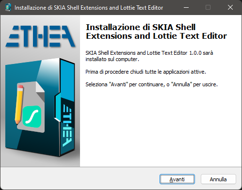
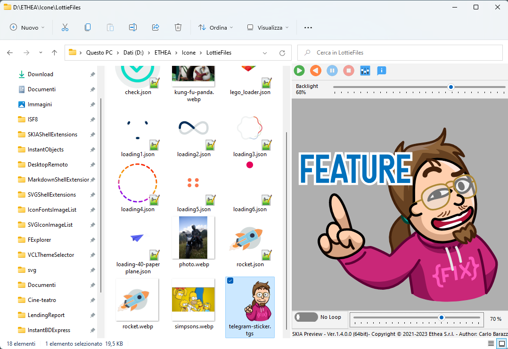
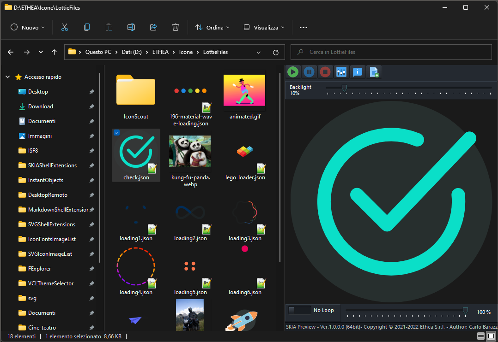
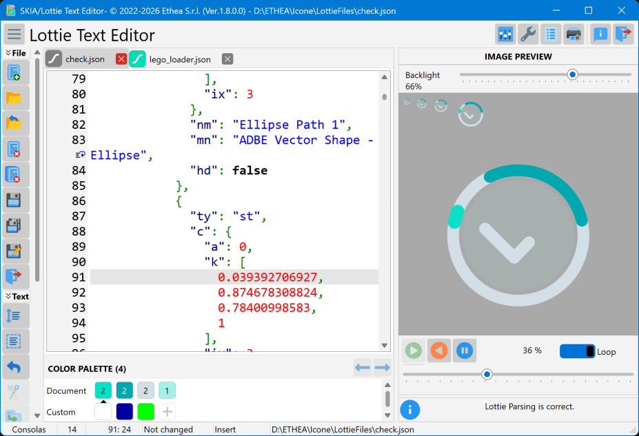
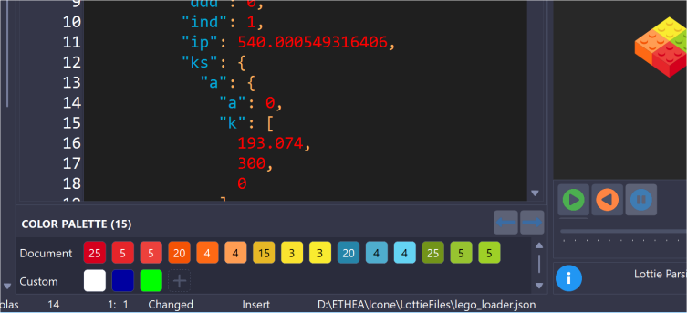
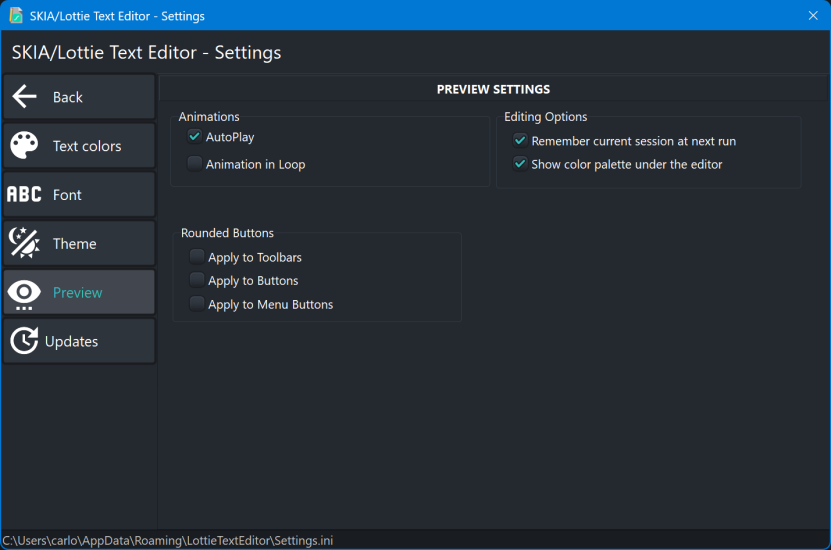
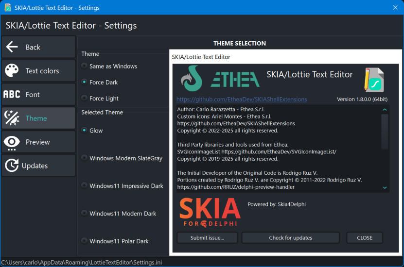

# SKIA Shell Extensions and Lottie Editor

Related links: [embarcadero.com][10] - [learndelphi.org][11]

**A collection of extensions tools for image and animations files, integrated into Microsoft Windows Explorer (10 and 11):**

- A [Preview handler][1]  which allows you to see static images and animations files in the "Preview Panel".
 
- A [Thumbnail handler][2] which allows you to see static images and anomations files (the last last frame of animation) into Windows Explorer.

- A [Lottie Text Editor][12] to manually edit and preview the animation of Lottie files.

### Animation and file extensions supported:

**.json** or **.lottie**: animated Lottie files [lottiefiles.com](https://lottiefiles.com/)

**.gif**: static and animated Gif [W3C GIF (tm)](https://www.w3.org/Graphics/GIF/spec-gif87.txt)

**.webp**: static and animated webp [An image format for the Web](https://developers.google.com/speed/webp)

**.tgs**: animated telegram stickers [core.telegram.org/stickers](https://core.telegram.org/stickers)

---

### Features

- Supports Windows 10 and 11 (for 32 bits and 64 bits).

- Themes (Dark and Light) according to user preferences of Windows Theme

- Play normal, inverse or manual control

- AutoPlay and Loop of animation when selected into Explorer

### Setup using the Installer

Click to download the [SKIAShellExtensionsSetup.exe][3] located also in the Release area. The Installer works both for 32 and 64 bit system.

***For a clean Setup close all the windows explorer instances which have the preview handler active or the preview handler was used (remember the dll remains in memory until the windows explorer was closed).***

### Preview Panel and Thumbnails in action ###

In Windows 11 with Light theme:

In Windows 11 with Dark theme:

### Lottie Text Editor

A useful Text editor with preview and animation of Lottie files:

**Color palette**: under the editor a panel shows all the colors used by the Lottie animation, with the number of occurrences of each one. In a Lottie file a color is an array of numbers (`[r,g,b,a]` from 0 to 1, or from 0 to 255 in old exports), recognized by where it is: fill and stroke colors (also animated, every keyframe), gradient stops, solid layers (`"sc":"#rrggbb"`), text fill and stroke, color effects and slots; the same color written with a different precision is shown once.

- Click on a color to highlight all its occurrences in the text, then move between them with `Alt+Right` / `Alt+Left` or with the arrow buttons of the palette.
- When the caret is on a color value, the corresponding color is marked in the palette.
- Double-click on a color to replace the color value under the caret, keeping the notation of the file (number of components, precision, alpha, scale, offset of a gradient stop).
- Right-click on a color to replace all its occurrences with another color (one single undo), to select all its occurrences with multiple carets, or to copy its value.
- Add your own colors to the "Custom" section with the `+` button (color picker) or from the context menu: they are kept for all files and shared with the custom colors of the color picker.
- The hint of each color shows its value, the properties using it and its opacities.
- The palette can be hidden in the Settings ("Show color palette under the editor").

### Automatic updates

The Lottie Text Editor checks if a new version is available on GitHub, then downloads and installs it:

- **Automatic check**: at startup, once every *n* days (7 by default), in background; it can be disabled or its interval changed in Settings - Updates.
- **Manual check**: with the "Check for updates" button of the About dialog.

### Settings: Preview page

### Settings: Theme page

### Manual Build and Installation (for Delphi developers) ###

If you have Delphi 12 or Delphi 13, you can manually build the project:

***Warning: To build the DLL you need also other open-source projects***

- [SVGIconImageList][4]

- [Synedit][5]

- [VCL-Style-Utils][6]

- [Skia4Delphi][13]

To manually install the SKIAShellExtensions.dll follow these steps:

1. Close all the windows explorer instances which have the preview handler active or the preview handler was used (remember the dll remains in memory until the windows explorer was closed).
  
2. If you have already used the installer uninstall the components from system.
     
3. To Uninstall/Install manually the dll run the `Unregister_Register.cmd` (run-as-administrator).

4. If you want to continue to change code and rebuild the dll, Unregister the dlls and beware to close all Explorer instances.

## Release Notes ##

14 Oct 2026: ver. 1.8.0
- Lottie Text Editor: new Color palette panel under the editor, showing the colors of the animation (fill and stroke, also animated, gradient stops, solid layers, text, color effects and slots), grouped by color with the number of occurrences and a hint with value, properties and opacities.
- Lottie Text Editor: click on a palette color to highlight all its occurrences in the text; move between them with Alt+Right / Alt+Left or with the arrow buttons of the palette. The palette marks the color under the editor caret.
- Lottie Text Editor: double-click on a palette color to replace the color under the caret, keeping the notation of the file (number of components, precision, alpha, 0..1 or 0..255 scale, offset of a gradient stop).
- Lottie Text Editor: palette context menu to replace all the occurrences of a color (one undo), select them with multiple carets, copy the color value, add or remove custom colors; option in Settings to show or hide the palette.
- Fixed a GDI handle and memory leak in the Thumbnail provider: every generated thumbnail leaked resources inside the Explorer process.
- The shared resources data module is now a single instance created on demand, instead of one created and destroyed by every preview.
- Preview: the text of Lottie files with non-ASCII characters is read as UTF-8.
- Lottie Text Editor: the first Undo no longer empties the file just opened.
- Lottie Text Editor: the animation is no longer reloaded at every keystroke.
- Lottie Text Editor: files whose extension is uppercase (.JSON) can now be opened.
- Lottie Text Editor: closing with unsaved changes can now be cancelled; fixed the management of the tabs on errors and when closing the first tab; Save all continues after a file that cannot be saved.
- Lottie Text Editor: the gutter of the editor follows the dark styles.
- The new-version check runs in background at startup, respects the "Automatic check" option and its interval, and no longer crashes when the download starts right after the automatic check.
- Added the styles "Windows11 Modern Light" and "Windows11 Modern Dark" (the default ones on Windows 11); a stored style no longer available falls back to the default one instead of raising an error.
- Setup: the Skia library is installed also with the Editor or the Viewer alone.

03 Jun 2026: ver. 1.7.1
- Added single-instance behavior: opening a file now reuses the running editor instead of starting a new one.
- Added Settings option to remember and reopen files from the last session.

07 Sep 2025: ver. 1.7.0
- Built with Delphi 13
- Refactoring PageControl to speedup loading
- Added Animation Viewer
- Added check for new version available, download and install
- Updated Setup

02 Mar 2024: ver. 1.6.0
- Added "Wordwrap option" for the editor (active by default)
- Updated the latest Image32 library
- Added Color options in Editor GUI
- Updated to Image32 4.6 Released Feb 2025 to fix some drawing issue

12 May 2024: ver. 1.5.4
- Added StyledComponents (Rounded Buttons options)
- Added init for GDI+Plus to Dll's
- Deleted unused images

09 May 2024: ver. 1.5.3
- Added File Changed notification and reload
- Built with Delphi 12.1
- Built with Latest Image32 Library
- Built with Latest Skia4Delphi 6.1 Library

13 Jan 2024: ver. 1.5.2
- Aligned to Image32 Library
- Updated Copyright

26 Oct 2023: ver. 1.5.1
- Optimized rendering of Icon using the Skia Codec directly
- Enabled system draw for title and border of Editor when Styled

25 Oct 2023: ver. 1.5.0
- Added "close button" over Tabs in Editor
- Updated to Skia4Delphi 6.0.0-beta 5
- Fixed enabling of Inverse Play Button
- Built with Delphi 12

12 Mar 2023: ver. 1.4.0
- Added "inverse" animation to Preview and Editor

27 Feb 2023: ver. 1.3.0
- Updated to Skia4Delphi 4.1.1
- Updated Projects to Delphi 11.3

13 Jan 2023: ver. 1.2.0
- Updated to Skia4Delphi 4.0.2
- Fixed Animation Panel of Preview

09 Nov 2022: ver. 1.1.0
- Updated to Skia4Delphi 4.0.1
- Fixed settings filename

24 Set 2022: ver. 1.0.1
- Fixed Setup registering 32bit dll
- Fixed settings filename

23 Set 2022: ver. 1.0.0
- First version

## Credits

Many thanks to **Rodrigo Ruz V.** (author of [theroadtodelphi.com][7] Blog) for his wonderful work on [delphi-preview-handler][8] from which this project has used a lot of code and inspiration.

## Powered by Skia4Delphi

Many thanks to the project "Skia4Delphi"

**[Skia4Delphi](https://skia4delphi.org)** is a cross-platform 2D graphics API for Delphi based on [Google's Skia](https://skia.org/) graphics library.

## License

Licensed under the [Apache License, Version 2.0][9] (the "License");
Unless required by applicable law or agreed to in writing, software distributed under the License is distributed on an "AS IS" BASIS, WITHOUT WARRANTIES OR CONDITIONS OF ANY KIND, either express or implied. See the License for the specific language governing permissions and limitations under the License.

The Initial Developer of the [Original Code][8] is **Rodrigo Ruz V**. Portions created by him are Copyright © 2011-2021 Rodrigo Ruz V.

Third Party libraries and tools used from Ethea:

- [SVGIconImageList][4]

Third Party libraries and tools used:

- [VCLStyles Utils][6]

- [SynEdit][5]

- [Skia4Delphi][13]

Related links: [embarcadero.com][10] - [learndelphi.org][11]

[1]: https://docs.microsoft.com/en-us/windows/win32/shell/preview-handlers

[2]: https://docs.microsoft.com/en-us/windows/win32/shell/thumbnail-providers

[3]: https://github.com/EtheaDev/SKIAShellExtensions/releases/latest/download/SKIAShellExtensionsSetup.exe

[4]: https://github.com/EtheaDev/SVGIconImageList

[5]: https://github.com/SynEdit/SynEdit

[6]: https://github.com/RRUZ/vcl-styles-utils

[7]: https://theroadtodelphi.com

[8]: https://github.com/RRUZ/delphi-preview-handler

[9]: https://opensource.org/licenses/Apache-2.0

[10]: https://www.embarcadero.com

[11]: https://learndelphi.org

[12]: https://github.com/EtheaDev/SKIAShellExtensions/wiki/Using-The-Lottie-Text-Editor

[13]: https://skia4delphi.org
